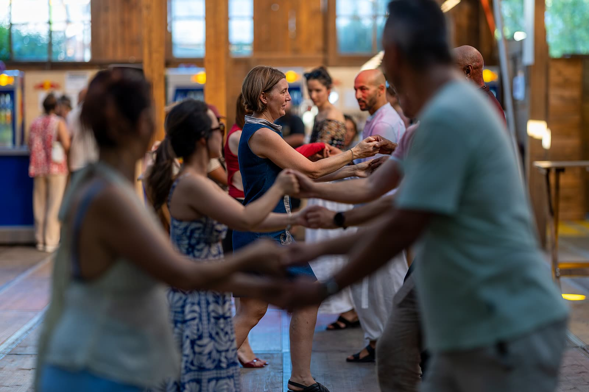

You have found a festival you like, opened the ticket page and met six options: full pass, party pass, VIP pass, couple pass, day pass, something called "Bronze+". Prices range from a few euros to several hundred. Which one do you actually need?

There is no standard. Each organizer decides what its passes include, and the same name can cover different things at two events. This guide explains the pass types you are most likely to meet at European salsa, bachata, kizomba, zouk, swing and tango events, what they usually cover, and the small print worth reading before you pay.

*Events named here are neutral examples based on their public pages as of 26 November 2026. They are not recommendations, and Revelti has no relationship with them. Some editions have already taken place; we use them to show how passes are structured, not as current offers.*

## The main pass types at a glance

| Pass | Usually includes | Often not included | Good for |
| :--- | :--- | :--- | :--- |
| Full pass | Workshops, shows and parties | Masterclasses, bootcamps, competitions, dinners | Learning and dancing all weekend |
| Party pass | Evening parties and shows | All or most workshops | Social dancers |
| Day pass or single entry | One day, or one evening | Everything outside that day | A taste, or a tight budget |
| VIP or master pass | Full pass plus extras | Varies | Masterclasses, reserved seats |
| Couple or role ticket | A full pass for one leader and one follower, or for one role | Same as the full pass | Getting in when roles are balanced |

Salsa Vida's guide to a first Latin dance festival lists most of these: full weekend passes, single-day passes, workshop-only passes, evening or party passes, and separate tickets for shows or competitions. Its key warning applies to every type: "A full pass may not include every bootcamp, concert, competition, pre-party, or afterparty."

## Full pass: the whole weekend (usually)

The full pass is the main ticket at most congresses and festivals. It normally covers the workshop program by day and the parties by night. It is also the ticket organizers use to manage numbers, so it is often the first to sell out and the one sold by role.

What a full pass leaves out varies. Three examples:

* **Latin Vibes Festival** (Copenhagen, March 2026) said a full pass was required to enter its social dance competition, the Bachata Meet Up. In that case the competition was included, but only for full pass holders.
* **Bachatasia World Congress** (Bormujos, Seville, March 2027) sells a Full Pass and a Full Pass VIP, plus hotel room packages that its ticket page marks "NO INCLUYE FULL PASS" (full pass not included). The room and the pass are separate purchases.
* **The Snowball** (Solna, Stockholm, December 2026), a swing festival, splits the idea of a full pass in two. The Silver pass covers one class track and the Gold pass covers two, both with the parties. Its New Year's Eve dinner is booked and paid separately.

If the pass description doesn't list something, assume it isn't included and ask.

*A salsa workshop during the 2026 Montreux Jazz Festival. Photo: Quejaytee, CC BY-SA 4.0, via Wikimedia Commons.*

## Party pass: the evenings only

A party pass gives you the evening program without the classes. It is usually much cheaper. On go&dance, the Elevation Bachata Congress in Belgrade (June 2026) listed a Full pass at 135 € and a Party Pass at 85 €.

What "the evenings" means also varies. The Snowball's Bronze pass is "parties only", and its Bronze+ pass adds the taster classes. At Herräng Dance Camp in Sweden, where prices are per week, the 2027 price list shows a Party pass at 3,600 SEK, compared with 6,500 SEK for a full-time class track.

A party pass suits you if you mainly want to social dance, already take regular classes at home, or are visiting the event for the atmosphere. Check whether it includes the shows, which often take place before the evening party.

## Day passes and single entries

Many events sell one day, or one evening, on its own. At The Snowball, an evening ticket at the door cost 450 SEK and included the late-night dance. Herräng sells a one-day class pass, a single class and a single evening entrance, but says these "can not be pre-booked". You buy them on site.

Day and evening tickets are a good way to try a format before committing to a whole weekend. The catch: they are not always on sale in advance, and they can sell out when the event is busy.

## VIP, master and premium passes

At the top end, names multiply. Life Málaga Latin Congress (Benalmádena, March 2027) is listed on Salsa Vida with a Full Pass at €90, a Dancer Pass at €70, a Premium Pass at €110 and a VIP Pass at €130, while the same listing warns that ticket details "may be announced closer to the event". A listing like this tells you the price ladder but not what each step adds.

VIP and master passes often add masterclasses with the headline artists, reserved seating at the shows or extra parties. If the difference isn't written down, ask the organizer before you pay the higher price.

## Couple passes and leader or follower tickets

Partner dances need people in both roles, so many organizers sell tickets by role or by couple:

* **Elevation Bachata Congress 2027** in Belgrade lists a "Full Pass - Leader" and a "Full Pass - Follower" at the same price.
* **Latin Vibes Festival 2026** sold its last-minute full pass as Fullpass (Leader) and Fullpass (Follower).
* **Barcelona Tango Marathon** (April 2026) offered a discount: "save €10 each if you register as a couple (leader-follower)".
* **Herräng Dance Camp** puts people on a waiting list when a course "is not balanced between leaders and followers", and couples who register together "automatically skip the waiting list" as long as the course hasn't sold out.

If you dance the role that is in shorter supply (often leading), you may get in faster. If you dance the more common role, registering with a partner can be the difference between a place and a waiting list. Our [companion guide for organizers](/blog/festival-pass-design-role-balance/) explains why events do this.

## Early bird, regular and late prices

Most events raise prices in steps as the date approaches. Two clear examples:

* **Latin Vibes Festival 2026** published four full pass prices: 115 € for the first 20 passes, then 130 €, 145 € and finally 165 € until the event.
* **Barcelona Tango Marathon 2026** charged 110 € until 12 December 2025, 125 € from 13 December and 140 € from 27 February 2026.

The gap between the first and last price was 50 € in Copenhagen and 30 € in Barcelona. If you are sure you are going, early booking saves money. If you are not sure, read the refund rules first.

## Refunds, resale and name changes

This is the part of the small print that matters most, because the law gives you less protection than you might expect.

**No 14-day cooling-off period.** In the EU you can usually cancel an online purchase within 14 days. The official Your Europe portal lists concert tickets among the exceptions. Spain's consumer law (Real Decreto Legislativo 1/2007, article 103, letter l) excludes leisure services contracted for a specific date or period from the right of withdrawal. In practice, a festival pass bought online is usually covered only by the organizer's own terms.

**Organizers' terms vary a lot.** Some examples:

* The Snowball says plainly: "We give NO refunds." You can, however, sell your pass to someone who is not yet registered and email the organizer with their name. Passes can't be shared.
* Herräng allows a transfer only if the other person has registered for "exactly the same course and the same role".
* The ticket platform LaSalsaDelBaile, which sells passes for several Spanish congresses, says you can change the holder or resell a ticket only if the offer you bought allows it.

Before you pay, look for three things: whether you get a refund if you cancel, whether you can transfer the pass to someone else, and whether a transfer has to match your role.

## If you organize events

Attendees compare passes in seconds. Say what each pass includes, list what costs extra (masterclasses, bootcamps, dinners, hotel packages), give the dates of each price step, and publish your refund and transfer rules next to the buy button. Our guide on [structuring passes and balancing leaders and followers](/blog/festival-pass-design-role-balance/) goes into more detail.

## If you photograph or film events

None of the ticket pages we read for this guide mentions a media or press pass. If you want to shoot at a festival, contact the organizer before you buy a ticket and ask whether there is an official media team and what its access includes.

## Before you buy: a checklist

* Read what each pass includes, line by line. If something isn't listed, ask.
* Check whether masterclasses, bootcamps, competitions and the after-party are extra.
* Check whether the shows are in the party pass.
* Look for role or couple tickets, and whether your role has a waiting list.
* Note the date of the next price rise.
* Read the refund, transfer and name-change rules before you pay.
* Check the venue address and whether a hotel package includes the pass.

*Last reviewed: 26 November 2026. Prices, pass names and terms change between editions. Always check the organizer's current page.*

## Sources

Event details (dates, venues, pass names, prices and terms) come from each event's public page or listing, as read on 26 November 2026.

**Guides and consumer rules**

* Takeshi Young, ["Your First Latin Dance Festival: What to Expect, How to Prepare, and What to Pack"](https://www.salsavida.com/articles/first-latin-dance-festival/), Salsa Vida
* Your Europe (European Union), ["Returns and the right of withdrawal"](https://europa.eu/youreurope/citizens/consumers/shopping/returns/index_en.htm), last checked 28 April 2026
* Boletín Oficial del Estado, ["Real Decreto Legislativo 1/2007"](https://www.boe.es/buscar/act.php?id=BOE-A-2007-20555), Spanish consumer law, article 103 (in Spanish)

**Events and ticket pages**

* Salsero, ["Bachatasia World Congress 2027"](https://salsero.es/events/10621)
* go&dance, ["Elevation Bachata Congress 2026"](https://www.goandance.com/es/evento/8878/elevation-bachata-congress-2026) and ["Elevation - Belgrade Bachata Congress 2027"](https://www.goandance.com/en/event/9887/elevation-belgrade-bachata-congress-2027)
* go&dance, ["Latin Vibes Festival 2026"](https://www.goandance.com/es/evento/8050/latin-vibes-festival-2026)
* Salsa Vida, ["Life Málaga Latin Congress 2027"](https://www.salsavida.com/event/spain/andalucia/malaga/life-malaga-latin-congress/)
* LaSalsaDelBaile, ["Bachazouk World Congress 2026"](https://www.lasalsadelbaile.com/bachazoukwc2026)
* The Snowball, ["Pricing"](https://www.thesnowball.se/event-pricing) and ["Registration"](https://www.thesnowball.se/registration)
* Herräng Dance Camp, ["HDC 2027 Overview"](https://www.herrang.com/2027/overview)
* Barcelona Tango Marathon, ["Barcelona Tango Marathon 2026"](https://www.barcelonatangomarathon.com/)

**Photos**

* Evening party at Beantown Lindy Hop Camp 2023: Sdkb, ["Beantown Lindy Hop Camp 2023 soul party evening dance in The Lodge"](https://commons.wikimedia.org/wiki/File:Beantown_Lindy_Hop_Camp_2023_soul_party_evening_dance_in_The_Lodge.jpg), [CC BY-SA 4.0](https://creativecommons.org/licenses/by-sa/4.0/), via Wikimedia Commons. Resized.
* Salsa workshop: Quejaytee, ["Salsa Workshop at El Mundo during the 2026 Montreux Jazz Festival 05"](https://commons.wikimedia.org/wiki/File:Salsa_Workshop_at_El_Mundo_during_the_2026_Montreux_Jazz_Festival_05.jpg), [CC BY-SA 4.0](https://creativecommons.org/licenses/by-sa/4.0/), via Wikimedia Commons. Resized.
