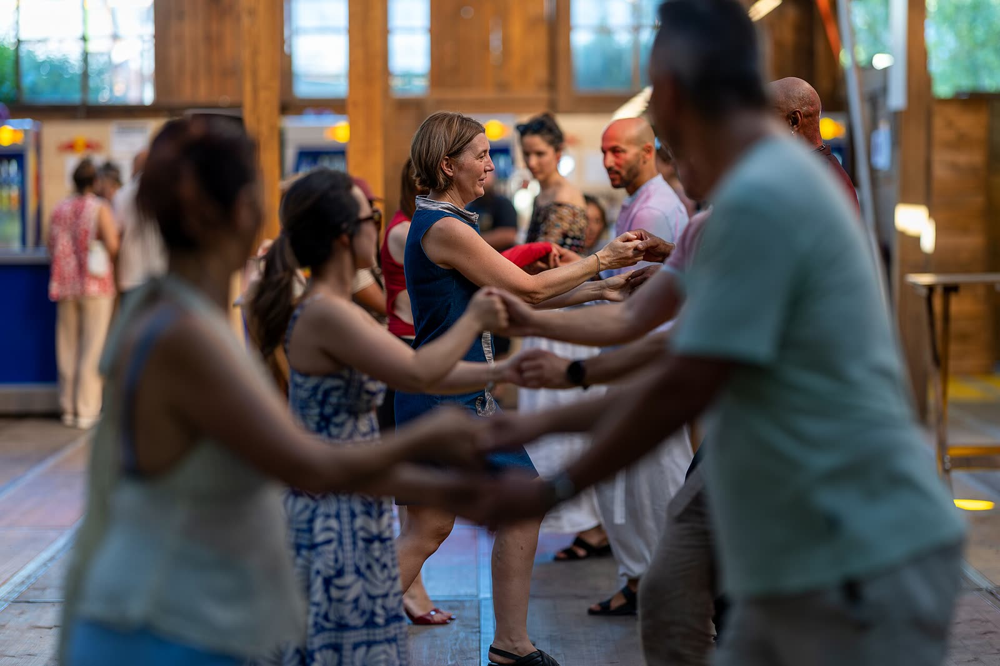

En los congresos de salsa y bachata en España casi nadie dice "pase completo": se dice *full pass*. Y junto a él aparecen el *party pass*, el pase VIP, el pase de pareja, entradas de líder y de follower y, a veces, nombres que no explican nada, como "Premium" o "Dancer Pass". El precio puede ir de unos pocos euros a varios cientos.

No hay un estándar. Cada organización decide qué incluye cada pase, y un mismo nombre puede significar cosas distintas en dos eventos. Esta guía repasa los pases más habituales en congresos y festivales europeos de baile social, qué suelen cubrir y qué letra pequeña conviene leer antes de pagar. Empezamos por lo que más sorprende: las devoluciones.

*Los eventos citados son ejemplos neutrales, según sus páginas públicas a 26 de noviembre de 2026. No son recomendaciones y Revelti no tiene ninguna relación con ellos. Algunas ediciones ya se han celebrado; las usamos para mostrar cómo se estructuran los pases, no como ofertas vigentes.*

## Antes de nada: un pase no tiene 14 días de desistimiento

Muchas personas dan por hecho que cualquier compra por internet se puede anular en 14 días. Con las entradas de un evento no suele ser así.

La ley española de consumidores (Real Decreto Legislativo 1/2007, artículo 103, letra l) excluye del derecho de desistimiento los servicios relacionados con actividades de esparcimiento cuando el contrato fija una fecha o un periodo concretos. El portal oficial de la Unión Europea, Your Europe, cita las entradas de conciertos entre las excepciones al plazo de 14 días.

En la práctica, si compras un *full pass* y luego no puedes ir, dependes de las condiciones de la organización. Y esas condiciones cambian mucho de un evento a otro:

* **The Snowball** (Solna, Estocolmo), un festival de swing, lo dice sin rodeos: no hace devoluciones ("We give NO refunds"). Sí permite vender tu pase a otra persona que aún no esté inscrita, avisando por correo a la organización. El pase no se puede compartir.
* **Herräng Dance Camp** (Suecia) solo acepta una transferencia si la otra persona se ha inscrito en "exactamente el mismo curso y el mismo rol" (traducción de Revelti).
* **LaSalsaDelBaile**, la plataforma que vende pases de varios congresos españoles, indica que puedes cambiar el titular o revender la entrada solo si la oferta que compraste lo permite.

Antes de pagar, busca tres cosas: si te devuelven el dinero si cancelas, si puedes ceder el pase a otra persona y si la cesión tiene que respetar tu rol.

## Los pases, de un vistazo

| Pase | Suele incluir | A menudo no incluye | Para quién |
| :--- | :--- | :--- | :--- |
| *Full pass* | Talleres, shows y fiestas | Masterclasses, bootcamps, competiciones, cenas | Aprender y bailar todo el fin de semana |
| *Party pass* | Fiestas de noche y shows | Todos o casi todos los talleres | Quien va sobre todo a bailar |
| Pase de día o entrada suelta | Un día o una noche | Todo lo demás | Probar o ajustar el presupuesto |
| VIP, *master* o premium | *Full pass* con extras | Depende del evento | Masterclasses, asientos reservados |
| Pase de pareja o por rol | El pase para una pareja de líder y follower, o para un rol | Lo mismo que el *full pass* | Entrar cuando se equilibran los roles |

La guía de Salsa Vida para un primer festival de baile latino recoge casi todos: pases de fin de semana completos, pases de un solo día, pases solo para talleres y pases de noche o fiesta. Y avisa de algo que vale para todos: "Es posible que un pase completo no incluya todos los bootcamps, conciertos, competiciones".

## El *full pass*: casi todo, no todo

Es la entrada principal de un congreso: talleres de día y fiestas de noche. También es el pase con el que la organización controla el aforo, así que suele ser el primero en agotarse y el que se vende por rol.

Lo que deja fuera depende del evento:

* **Bachatasia World Congress** (Bormujos, Sevilla, marzo de 2027) vende un Full Pass y un Full Pass VIP, además de paquetes de hotel marcados como "NO INCLUYE FULL PASS". Habitación y pase se compran por separado.
* **Latin Vibes Festival** (Copenhague, marzo de 2026) exigía el pase completo para participar en su competición de baile social: "es necesario tener un pase completo".
* **The Snowball** divide el pase completo en dos: el Silver incluye un itinerario de clases y el Gold, dos, ambos con las fiestas. La cena de Nochevieja se reserva y se paga aparte.

Si la descripción del pase no menciona algo, da por hecho que no está incluido y pregunta.

*Taller de salsa durante el Montreux Jazz Festival de 2026. Foto: Quejaytee, CC BY-SA 4.0, vía Wikimedia Commons.*

## El *party pass*: solo las noches

Da acceso al programa de noche sin las clases y cuesta bastante menos. En go&dance, el Elevation Bachata Congress de Belgrado (junio de 2026) anunciaba un Full pass a 135 € y un Party Pass a 85 €.

"Las noches" tampoco significa lo mismo en todas partes. En The Snowball, el pase Bronze es solo fiestas y el Bronze+ añade las clases de prueba. En Herräng, donde los precios son por semana, la lista de 2027 pone el Party pass a 3.600 coronas suecas, frente a 6.500 por un itinerario de clases completo.

El *party pass* te encaja si vas sobre todo a bailar, si ya das clases en tu ciudad o si quieres conocer el ambiente sin comprometerte con un fin de semana de talleres. Comprueba si incluye los shows, que muchas veces van justo antes de la fiesta.

## Pases de día y entradas sueltas

Muchos eventos venden un día o una noche por separado. En The Snowball, la entrada de noche en taquilla costaba 450 coronas e incluía el baile de madrugada. Herräng vende pase de clases de un día, clase suelta y entrada de noche, pero no se pueden reservar por adelantado: se compran allí.

Son una buena forma de probar un formato, con una pega: no siempre están a la venta antes y, si el evento se llena, pueden agotarse.

## VIP, *master*, premium y otros nombres

En la parte alta de la escala los nombres se multiplican. El Life Málaga Latin Congress (Benalmádena, marzo de 2027) aparece en Salsa Vida con un Full Pass a 90 €, un Dancer Pass a 70 €, un Premium Pass a 110 € y un VIP Pass a 130 €, y la misma ficha avisa de que los detalles de las entradas pueden anunciarse más adelante. Sabes cuánto cuesta cada escalón, pero no qué añade.

Los pases VIP o *master* suelen sumar masterclasses con los artistas principales, asientos reservados en los shows o fiestas extra. Si la diferencia no está por escrito, pregunta antes de pagar el precio más alto.

## Pase de pareja y entradas de líder o follower

En los bailes en pareja hacen falta personas en los dos roles, así que muchas organizaciones venden por rol o por pareja:

* **Elevation Bachata Congress 2027** (Belgrado) tiene un "Full Pass - Leader" y un "Full Pass - Follower" al mismo precio.
* **Latin Vibes Festival 2026** vendía su último tramo como Fullpass (Leader) y Fullpass (Follower).
* **Barcelona Tango Marathon** (abril de 2026) descontaba 10 € a cada persona si se inscribía en pareja de líder y follower.
* **Herräng Dance Camp** pone en lista de espera a quien se inscribe en un curso que no está equilibrado entre líderes y followers, y las parejas que se inscriben juntas se la saltan mientras queden plazas.

Si bailas el rol que escasea (a menudo, el de líder), puede que entres antes. Si bailas el rol más frecuente, inscribirte en pareja puede marcar la diferencia entre tener plaza o quedarte en lista de espera. En nuestra [guía para organizadores](/es/blog/pases-congreso-equilibrio-lideres-followers/) explicamos por qué los eventos funcionan así.

## Early bird, precio normal y última hora

Casi todos los eventos suben el precio por tramos a medida que se acerca la fecha:

* **Latin Vibes Festival 2026** publicó cuatro precios: 115 € para los 20 primeros pases, después 130 €, 145 € y, hasta el evento, 165 €.
* **Barcelona Tango Marathon 2026** cobraba 110 € hasta el 12 de diciembre de 2025, 125 € desde el 13 de diciembre y 140 € desde el 27 de febrero de 2026.

Entre el primer y el último precio había 50 € en Copenhague y 30 € en Barcelona. Si tienes claro que vas, comprar pronto compensa. Si no lo tienes claro, recuerda lo que hemos visto sobre devoluciones.

## Si organizas eventos

Quien compra compara pases en segundos. Explica qué incluye cada uno, di qué se paga aparte (masterclasses, bootcamps, cenas, paquetes de hotel), publica las fechas de cada subida de precio y pon tus condiciones de devolución y cesión junto al botón de compra. Nuestra guía sobre [cómo estructurar los pases y equilibrar líderes y followers](/es/blog/pases-congreso-equilibrio-lideres-followers/) entra en detalle.

## Si haces fotos o vídeo en eventos

Ninguna de las páginas de entradas que hemos consultado menciona un pase de prensa o de medios. Si quieres trabajar en un festival, escribe a la organización antes de comprar y pregunta si hay un equipo audiovisual oficial y qué acceso tiene.

## Antes de comprar

* Lee qué incluye cada pase, línea por línea. Si algo no aparece, pregunta.
* Comprueba si las masterclasses, los bootcamps, las competiciones y el *after party* se pagan aparte.
* Mira si el *party pass* incluye los shows.
* Busca entradas por rol o de pareja, y si tu rol tiene lista de espera.
* Apunta la fecha de la próxima subida de precio.
* Lee las condiciones de devolución y de cambio de titular antes de pagar.
* Revisa la dirección de la sede y si el paquete de hotel incluye el pase.

*Última revisión: 26 de noviembre de 2026. Precios, nombres de pases y condiciones cambian de una edición a otra; consulta siempre la página actual de la organización.*

## Fuentes

Las citas de fuentes en inglés están traducidas por Revelti. Los datos de cada evento (fechas, sedes, pases, precios y condiciones) proceden de su página pública o de su ficha en directorios de eventos, consultadas el 26 de noviembre de 2026.

**Normativa y guías**

* Boletín Oficial del Estado, ["Real Decreto Legislativo 1/2007, por el que se aprueba el texto refundido de la Ley General para la Defensa de los Consumidores y Usuarios"](https://www.boe.es/buscar/act.php?id=BOE-A-2007-20555), artículo 103
* Your Europe (Unión Europea), ["Devoluciones y derecho de desistimiento"](https://europa.eu/youreurope/citizens/consumers/shopping/returns/index_es.htm), última comprobación 28 de abril de 2026
* Takeshi Young, ["Tu primer festival de baile latino"](https://www.salsavida.com/es/articles/first-latin-dance-festival/), Salsa Vida

**Eventos y páginas de entradas**

* Salsero, ["Bachatasia World Congress 2027"](https://salsero.es/events/10621)
* Salsa Vida, ["Life Málaga Latin Congress 2027"](https://www.salsavida.com/event/spain/andalucia/malaga/life-malaga-latin-congress/) (en inglés)
* LaSalsaDelBaile, ["Bachazouk World Congress 2026"](https://www.lasalsadelbaile.com/bachazoukwc2026)
* Barcelona Tango Marathon, ["Barcelona Tango Marathon 2026"](https://www.barcelonatangomarathon.com/) (en inglés)
* go&dance, ["Elevation Bachata Congress 2026"](https://www.goandance.com/es/evento/8878/elevation-bachata-congress-2026), ["Elevation - Belgrade Bachata Congress 2027"](https://www.goandance.com/en/event/9887/elevation-belgrade-bachata-congress-2027) y ["Latin Vibes Festival 2026"](https://www.goandance.com/es/evento/8050/latin-vibes-festival-2026)
* The Snowball, ["Pricing"](https://www.thesnowball.se/event-pricing) y ["Registration"](https://www.thesnowball.se/registration) (en inglés)
* Herräng Dance Camp, ["HDC 2027 Overview"](https://www.herrang.com/2027/overview) (en inglés)

**Fotos**

* Fiesta de noche en el Beantown Lindy Hop Camp 2023: Sdkb, ["Beantown Lindy Hop Camp 2023 soul party evening dance in The Lodge"](https://commons.wikimedia.org/wiki/File:Beantown_Lindy_Hop_Camp_2023_soul_party_evening_dance_in_The_Lodge.jpg), [CC BY-SA 4.0](https://creativecommons.org/licenses/by-sa/4.0/deed.es), vía Wikimedia Commons. Redimensionada.
* Taller de salsa: Quejaytee, ["Salsa Workshop at El Mundo during the 2026 Montreux Jazz Festival 05"](https://commons.wikimedia.org/wiki/File:Salsa_Workshop_at_El_Mundo_during_the_2026_Montreux_Jazz_Festival_05.jpg), [CC BY-SA 4.0](https://creativecommons.org/licenses/by-sa/4.0/deed.es), vía Wikimedia Commons. Redimensionada.
