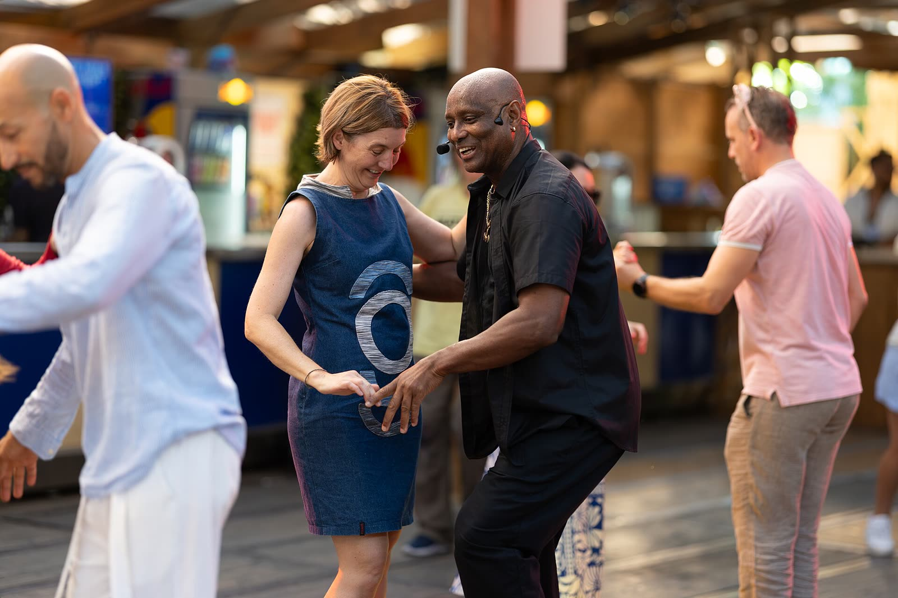

Your pass structure is the first thing most people read about your event, often before the line-up. It decides who comes, how much they pay and when, and, in partner dancing, whether there are enough leaders and followers once the music starts.

This guide looks at how European salsa, bachata, swing and tango events structure their passes and manage role balance, based on what they publish on their own pages. There is no single right model. The aim is to show the options and what each one solves.

*Events named here are neutral examples based on their public pages as of 26 November 2026. They are not recommendations, and Revelti has no relationship with them. Several editions have already taken place; we use them to show how registration is set up.*

## Start with what people actually want to buy

Most events build a ladder of passes around three things: classes, parties and extras. The common rungs:

| Pass | What it covers | Why offer it | Watch out for |
| :--- | :--- | :--- | :--- |
| Full pass | Classes and parties | Your core product, easiest to balance by role | Saying clearly what is not included |
| Party pass | Evenings only | Social dancers and locals | Whether shows are included |
| Classes-only pass | Workshops, no parties | Dancers who skip late nights | Rarely offered, so explain it |
| Single day or evening | One slot | Trying the event, filling the room | Selling it in advance or only at the door |
| VIP or extras | Masterclasses, seats, dinners | Higher spend per guest | Listing exactly what the extra money buys |

Four structures from the events we read:

* **The Snowball** (Solna, Stockholm, December 2026) names its passes after metals: Gold for two class tracks plus parties, Silver for one track plus parties, Bronze for parties only, Bronze+ for parties plus taster classes, and Crystal for classes only. Each line on its pricing page lists what the pass includes.
* **ILHC Europe** (October 2026), a Lindy Hop championship, sells a Party Pass for all five nights and access to the competition floor, plus class "modules" at 45 € each that don't require a Party Pass. Competition entries are bought separately, and "You'll need a Party Pass to compete."
* **Fallin' for Swing** in Odense, Denmark (October 2026) sold full passes per level (Lindy Hop Intermediate, Lindy Hop Advanced, Collegiate Shag) at 650 DKK, plus party passes per night and a separate community dinner.
* **Herräng Dance Camp** (Sweden) prices everything per week and sells single classes, days and evenings only on site: they "can not be pre-booked".

A modular structure like ILHC's or Herräng's lets people build their own weekend. A short ladder like The Snowball's is easier to compare. Either way, people should be able to tell in one read what each pass includes.

## Price in steps, and publish the dates

Most events raise prices as the date approaches. **Latin Vibes Festival** (Copenhagen, March 2026) published four full pass prices: 115 € for the first 20 passes, 130 € until 15 September 2025, 145 € until 1 January 2026, and 165 € until the event. **Barcelona Tango Marathon** (April 2026) published three, each with a date: 110 €, 125 € and 140 €.

Publishing the dates of each step lets people plan. Limiting the first tier to a number of passes, as Latin Vibes did, rewards the people who commit first.

## Why role balance matters

In partner dancing, an imbalance means people sitting out. The Tango Marathon Directory (TMD) measures it as the number of followers divided by the number of leaders. It says open tango events often have more than two followers per leader, while closed, curated events such as marathons usually get below 1.2.

Even 1.2 is noticeable. TMD works through an example with 180 dancers: at that ratio, when every leader is dancing, about 16 followers are left sitting, "almost 20% of all followers". Its terminology page says marathons aim for a guest list that is equal in followers and leaders, and that "some say a quota of up to 4% more leaders works best".

Which role is short varies by dance and by moment. At Fallin' for Swing, the Shag intermediate class had too many leads, while the Lindy Hop classes had too many followers. That is why the tools below work best when you watch your numbers as registrations come in.

*Workshops need a matching number of leaders and followers. A salsa class during the 2026 Montreux Jazz Festival. Photo: Quejaytee, CC BY-SA 4.0, via Wikimedia Commons.*

## Six ways events manage balance

**1. Role-specific tickets.** Sell the same pass as a leader version and a follower version, so you can see and cap each role. Elevation Bachata Congress 2027 in Belgrade lists a "Full Pass - Leader" and a "Full Pass - Follower" at the same price. Latin Vibes Festival 2026 did the same with its last-minute full pass, and Copenhagen Bachata Congress 2026 sold an "Early Bird Full Pass - Leader".

**2. Closing one role for a while.** When one role runs ahead, pause it. Fallin' for Swing said so openly: "Right now, we have too many leads compared to followers, so we have temporarily closed registration for leads" for one class, and the opposite for another.

**3. Partner and couple registration.** A couple brings one of each role, so many events make it easier to register together. Fallin' for Swing sold partner tickets "only for two people who dance different roles". At Herräng, couples "automatically skip the waiting list, as long as the course is not sold out". Barcelona Tango Marathon gave a discount: "save €10 each if you register as a couple (leader-follower)". The Snowball lets couples sign up together and asks that "the leader sign up before the follower for our records".

**4. Waiting lists.** Herräng puts single registrations on a waiting list when a course "is not balanced between leaders and followers". Fallin' for Swing ran its waiting list by email. Say on your page how the list works and how people will hear from you.

**5. Curated registration.** Tango marathons and encuentros often choose their guests rather than selling first come, first served, which TMD names as the reason they reach close to equal numbers. It takes more work and is less common in salsa and bachata, where open sale is the norm.

**6. Counting people who dance both roles.** Some dancers lead and follow. At least one registration tool built for swing events shows "leaders, followers and switches as registrations arrive". None of the European events we read defined a separate switch ticket, so if you add one, explain how you will count those dancers.

## Competition entries and role

Competitions often sit on top of a pass. Copenhagen Bachata Congress said of its social competition: "You must hold a Full Pass to enter." ILHC Europe requires a Party Pass for any competition. Bachatasia World Congress 2027 (Bormujos, Seville) lists a "Full Pass + Registration Jack & Jill Leader" ticket, a way to combine the pass with a competition entry for one role.

## Refunds, transfers and role

In Spain, the right to cancel an online purchase within 14 days does not apply to leisure services booked for a specific date (Real Decreto Legislativo 1/2007, article 103, letter l). Your own policy therefore matters. The events we read use three models:

* **No refunds, resale allowed.** The Snowball: "We give NO refunds", but you can sell your pass to someone not yet registered and email the organizer. Fallin' for Swing had "a no-refund policy" with resale through the organizer.
* **A sliding scale.** Herräng's terms keep only an admin fee if you cancel 90 days or more before the camp, 50% between 46 and 89 days, and 75% within 45 days.
* **Transfers that keep the balance.** Herräng allows a transfer only to someone registered for "exactly the same course and the same role". This stops a resale from undoing your balance.

Our recommendation: write the policy once and use the same wording on your website, your ticket platform and any listing sites. In our reading, one event listing showed a refund deadline and "No cancellations accepted" on the same page, which leaves buyers guessing.

## A checklist for your pass page

* List what each pass includes and what costs extra.
* Give the date or number limit for every price step.
* Say whether passes are sold by role, and what happens when a role is full.
* Explain couple or partner registration, and whether partners must dance different roles.
* Explain how the waiting list works.
* State which passes allow competition entry.
* Publish refund, resale and name-change rules, and whether a transfer must keep the same role.
* Give the full venue address and the dates in one place.

## If you attend events

Role tickets and waiting lists are not a judgment on you. They protect the dancing for everyone. If your role is closed, registering with a partner of the other role is often the quickest way in. Our [attendee guide to full, party and day passes](/blog/dance-festival-passes-explained/) explains what each ticket usually covers.

## If you photograph or film events

The pass structure tells you where the crowd will be. Class tracks and modules spread people across rooms by day, party passes fill the evenings, and competitions happen at fixed times, often inside a party. Ask the organizer for the timetable by pass type when you plan coverage.

*Last reviewed: 26 November 2026. Pass names, prices and rules change between editions. Always check the organizer's current page.*

## Sources

Event details (dates, venues, pass names, prices and rules) come from each event's public page or listing, as read on 26 November 2026.

**Role balance**

* The Tango Marathon Directory, ["Role-balanced events. Why?"](https://www.tangomarathons.com/?p=48486)
* The Tango Marathon Directory, ["Terminology"](https://www.tangomarathons.com/terminology/)
* Swing You Later, ["For organizers"](https://swingyoulater.com/for-organizers) (registration software vendor)

**Events and registration pages**

* The Snowball, ["Pricing"](https://www.thesnowball.se/event-pricing) and ["Registration"](https://www.thesnowball.se/registration)
* ILHC Europe, ["Passes and Prices"](https://europe.ilhc.com/?p=408)
* Swing Central Odense, ["Fallin' for swing 2026"](https://swingcentralodense.nemtilmeld.dk/47/)
* Herräng Dance Camp, ["HDC 2027 Overview"](https://www.herrang.com/2027/overview) and ["Terms and Conditions"](https://www.herrang.com/terms-and-conditions)
* go&dance, ["Latin Vibes Festival 2026"](https://www.goandance.com/es/evento/8050/latin-vibes-festival-2026), ["Elevation - Belgrade Bachata Congress 2027"](https://www.goandance.com/en/event/9887/elevation-belgrade-bachata-congress-2027), ["Copenhagen Bachata Congress 2026"](https://goandance.com/en/event/8887/copenhagen-bachata-congress-2026) and ["Bachatasia World Congress 2027"](https://www.goandance.com/en/event/9370/bachatasia-world-congress-2027)
* Barcelona Tango Marathon, ["Barcelona Tango Marathon 2026"](https://www.barcelonatangomarathon.com/)

**Law**

* Boletín Oficial del Estado, ["Real Decreto Legislativo 1/2007"](https://www.boe.es/buscar/act.php?id=BOE-A-2007-20555), Spanish consumer law, article 103 (in Spanish)

**Photos**

* Salsa class: Quejaytee, ["Salsa Workshop at El Mundo during the 2026 Montreux Jazz Festival 03"](https://commons.wikimedia.org/wiki/File:Salsa_Workshop_at_El_Mundo_during_the_2026_Montreux_Jazz_Festival_03.jpg), [CC BY-SA 4.0](https://creativecommons.org/licenses/by-sa/4.0/), via Wikimedia Commons. Resized.
