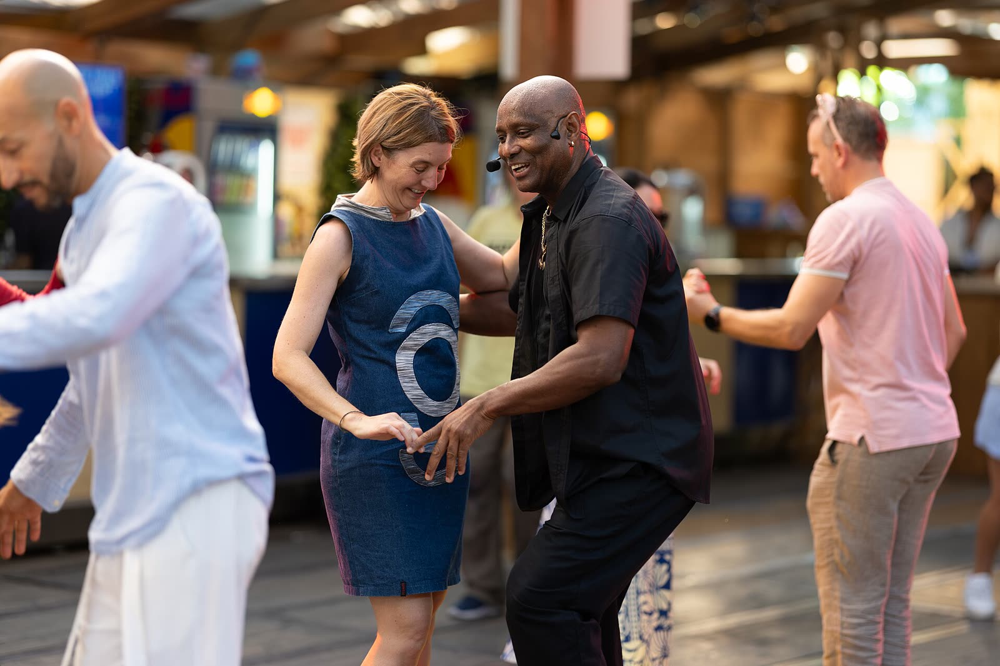

Cualquiera que haya organizado un taller de bachata conoce la escena: la clase empieza, se forman las parejas y sobran cinco personas de un mismo rol. En un congreso de tres días, ese desajuste se nota en cada taller y en cada fiesta. Y buena parte de la solución está en algo que se decide meses antes: cómo vendes los pases.

Esta guía repasa cómo estructuran sus pases y cómo equilibran los roles varios eventos europeos de salsa, bachata, swing y tango, a partir de lo que publican en sus propias páginas. No hay un modelo único. La idea es mostrar las opciones y qué resuelve cada una.

*Los eventos citados son ejemplos neutrales, según sus páginas públicas a 26 de noviembre de 2026. No son recomendaciones y Revelti no tiene ninguna relación con ellos. Varias ediciones ya se han celebrado; las usamos para mostrar cómo se organiza la inscripción.*

## Por qué importa el equilibrio de roles

Un desequilibrio significa gente sentada. El Tango Marathon Directory (TMD), un directorio internacional de eventos de tango, lo mide dividiendo el número de followers entre el de líderes. Según sus datos, en los eventos de tango abiertos suele haber más de dos followers por cada líder, mientras que los eventos cerrados y con inscripción seleccionada, como las maratones, suelen quedar por debajo de 1,2.

Incluso 1,2 se nota. TMD pone un ejemplo con 180 personas: con esa proporción, cuando todos los líderes están bailando, unos 16 followers se quedan sentados, "casi el 20 % de todos los followers" (traducción de Revelti). Su glosario explica que las maratones buscan una lista de invitados con el mismo número de líderes y followers, y que hay quien defiende un margen de hasta un 4 % más de líderes.

El rol que falta no siempre es el mismo. En el festival de swing Fallin' for Swing (Odense, Dinamarca, octubre de 2026), la clase intermedia de shag tenía demasiados líderes y las de lindy hop, demasiados followers. Por eso conviene vigilar las cifras a medida que llegan las inscripciones.

## Seis herramientas para equilibrar

**1. Entradas por rol.** El mismo pase en versión líder y versión follower, para ver y limitar cada rol. El Elevation Bachata Congress 2027 de Belgrado vende "Full Pass - Leader" y "Full Pass - Follower" al mismo precio. El Latin Vibes Festival 2026 (Copenhague) hizo lo mismo en su último tramo, y el Copenhagen Bachata Congress 2026 vendía un "Early Bird Full Pass - Leader".

**2. Cerrar un rol temporalmente.** Si un rol se adelanta, se pausa. Fallin' for Swing lo explicaba en su web: había cerrado temporalmente la inscripción de líderes en una clase "porque ahora mismo tenemos demasiados líderes en comparación con followers" (traducción de Revelti), y la de followers en otras.

**3. Inscripción en pareja.** Una pareja aporta una persona de cada rol, así que muchos eventos facilitan inscribirse juntos. Fallin' for Swing reservaba sus entradas de pareja a dos personas que bailen roles distintos. En Herräng Dance Camp (Suecia), las parejas se saltan la lista de espera mientras el curso no esté completo. La Barcelona Tango Marathon descontaba 10 € a cada persona que se inscribía en pareja de líder y follower. The Snowball (Estocolmo) permite inscribirse en pareja y pide que se registre primero quien lleva.

**4. Lista de espera.** Herräng deja en lista de espera a quien se inscribe solo en un curso que no está equilibrado entre líderes y followers. Fallin' for Swing la gestionaba por correo. Explica en tu web cómo funciona y cómo vas a avisar.

**5. Inscripción seleccionada.** Las maratones y los encuentros de tango suelen elegir a sus invitados en lugar de vender por orden de llegada, y TMD lo señala como la razón de que se acerquen a la paridad. Exige más trabajo y es poco habitual en salsa y bachata, donde lo normal es la venta libre.

**6. Contar a quien baila los dos roles.** Hay personas que llevan y que siguen. Al menos una herramienta de inscripción para eventos de swing muestra en tiempo real cuántos líderes, followers y *switches* hay. Ninguno de los eventos europeos que hemos consultado tiene una entrada específica para *switch*; si la creas, explica cómo vas a contar a esas personas.

*Un taller necesita tantos líderes como followers. Clase de salsa durante el Montreux Jazz Festival de 2026. Foto: Quejaytee, CC BY-SA 4.0, vía Wikimedia Commons.*

## La escalera de pases

Con el equilibrio en mente, toca decidir qué vendes. La mayoría de eventos combina tres piezas: clases, fiestas y extras.

| Pase | Qué cubre | Para qué sirve | Ojo con |
| :--- | :--- | :--- | :--- |
| *Full pass* | Clases y fiestas | El producto principal, el más fácil de vender por rol | Decir qué no incluye |
| *Party pass* | Solo las noches | Bailarines sociales y público local | Si incluye los shows |
| Pase solo de clases | Talleres, sin fiestas | Quien no trasnocha | Es poco común: explícalo |
| Día o noche suelta | Una franja | Probar el evento, llenar la sala | Venta anticipada o solo en taquilla |
| VIP o extras | Masterclasses, asientos, cenas | Mayor gasto por persona | Detallar qué paga ese extra |

Cuatro modelos reales:

* **The Snowball** (Solna, Estocolmo, diciembre de 2026) usa nombres de metales: Gold, dos itinerarios de clases y fiestas; Silver, uno y fiestas; Bronze, solo fiestas; Bronze+, fiestas y clases de prueba; Crystal, solo clases. Cada pase detalla lo que incluye.
* **ILHC Europe** (octubre de 2026), un campeonato de lindy hop, vende un Party Pass para las cinco noches con acceso a la pista de competición, y "módulos" de clases a 45 € que no exigen el Party Pass. Para competir, en cambio, hace falta el Party Pass.
* **Fallin' for Swing** vendía *full pass* por nivel (lindy hop intermedio y avanzado, shag) a 650 coronas danesas, *party pass* por noche y una cena aparte.
* **Herräng Dance Camp** pone precio por semana y vende clases, días y noches sueltas solo allí, sin reserva previa.

Un modelo por módulos, como el de ILHC o Herräng, permite a cada cual montarse su fin de semana. Una escalera corta, como la de The Snowball, es más fácil de comparar. En los dos casos, cada pase debería entenderse a la primera lectura.

## Precios por tramos, con fechas

Casi todos los eventos suben el precio por tramos. El Latin Vibes Festival 2026 publicó cuatro: 115 € para los 20 primeros pases, 130 € hasta el 15 de septiembre de 2025, 145 € hasta el 1 de enero de 2026 y 165 € hasta el evento. La Barcelona Tango Marathon 2026 publicó tres, cada uno con su fecha: 110 €, 125 € y 140 €.

Publicar la fecha de cada subida ayuda a planificar. Limitar el primer tramo a un número de pases, como hizo Latin Vibes, premia a quien se compromete antes.

## Competiciones y rol

Las competiciones suelen ir encima de un pase. El Copenhagen Bachata Congress exigía el *full pass* para su competición social, e ILHC Europe pide el Party Pass para cualquier competición. El Bachatasia World Congress 2027 (Bormujos, Sevilla) vende un "Full Pass + Registration Jack & Jill Leader", que une el pase y la inscripción de un rol en la competición.

## Devoluciones y cambios de titular

Según la ley española de consumidores (Real Decreto Legislativo 1/2007, artículo 103, letra l), el derecho a desistir de una compra en 14 días no se aplica a los servicios de ocio contratados para una fecha concreta. Así que tu política es la que cuenta. En los eventos consultados vemos tres modelos:

* **Sin devoluciones, con reventa.** The Snowball no devuelve el dinero, pero permite vender el pase a alguien que aún no esté inscrito y avisar por correo. Fallin' for Swing tenía la misma política de no devolución con reventa a través de la organización.
* **Escala según la antelación.** Las condiciones de Herräng retienen solo una tasa de gestión si cancelas con 90 días o más, el 50 % entre 46 y 89 días y el 75 % con 45 días o menos.
* **Cesiones que respetan el rol.** Herräng solo permite ceder la plaza a alguien inscrito en "exactamente el mismo curso y el mismo rol" (traducción de Revelti). Así una reventa no deshace el equilibrio.

Nuestra recomendación: redacta la política una vez y usa el mismo texto en tu web, en tu plataforma de venta y en los directorios de eventos. En una de las fichas consultadas aparecían a la vez un plazo de devolución y la frase "No cancellations accepted", algo que deja a quien compra con dudas.

## Lista para tu página de pases

* Qué incluye cada pase y qué se paga aparte.
* La fecha o el número de pases de cada tramo de precio.
* Si vendes por rol y qué pasa cuando un rol se llena.
* Cómo funciona la inscripción en pareja y si los dos deben bailar roles distintos.
* Cómo funciona la lista de espera.
* Qué pases permiten competir.
* Devoluciones, reventa y cambio de titular, y si la cesión debe mantener el rol.
* Dirección completa de la sede y fechas, en un solo sitio.

## Si vas a eventos

Las entradas por rol y las listas de espera no son nada personal: protegen el baile de todos. Si tu rol está cerrado, inscribirte con una pareja del otro rol suele ser la forma más rápida de entrar. En nuestra [guía sobre *full pass*, *party pass* y pase de día](/es/blog/entradas-congreso-de-baile-full-pass-party-pass/) explicamos qué suele incluir cada entrada.

## Si haces fotos o vídeo

La estructura de pases te dice dónde estará la gente: los itinerarios y módulos reparten a los asistentes por salas durante el día, el *party pass* llena las noches y las competiciones tienen hora fija, a menudo dentro de una fiesta. Pide a la organización el horario por tipo de pase para planificar tu cobertura.

*Última revisión: 26 de noviembre de 2026. Nombres de pases, precios y normas cambian de una edición a otra; consulta siempre la página actual de la organización.*

## Fuentes

Las citas de fuentes en inglés están traducidas por Revelti. Los datos de cada evento (fechas, sedes, pases, precios y normas) proceden de su página pública o de su ficha en directorios de eventos, consultadas el 26 de noviembre de 2026.

**Equilibrio de roles**

* The Tango Marathon Directory, ["Role-balanced events. Why?"](https://www.tangomarathons.com/?p=48486) (en inglés)
* The Tango Marathon Directory, ["Terminology"](https://www.tangomarathons.com/terminology/) (en inglés)
* Swing You Later, ["For organizers"](https://swingyoulater.com/for-organizers) (empresa de software de inscripción, en inglés)

**Eventos y páginas de inscripción**

* The Snowball, ["Pricing"](https://www.thesnowball.se/event-pricing) y ["Registration"](https://www.thesnowball.se/registration) (en inglés)
* ILHC Europe, ["Passes and Prices"](https://europe.ilhc.com/?p=408) (en inglés)
* Swing Central Odense, ["Fallin' for swing 2026"](https://swingcentralodense.nemtilmeld.dk/47/) (en inglés)
* Herräng Dance Camp, ["HDC 2027 Overview"](https://www.herrang.com/2027/overview) y ["Terms and Conditions"](https://www.herrang.com/terms-and-conditions) (en inglés)
* go&dance, ["Latin Vibes Festival 2026"](https://www.goandance.com/es/evento/8050/latin-vibes-festival-2026), ["Elevation - Belgrade Bachata Congress 2027"](https://www.goandance.com/en/event/9887/elevation-belgrade-bachata-congress-2027), ["Copenhagen Bachata Congress 2026"](https://goandance.com/en/event/8887/copenhagen-bachata-congress-2026) y ["Bachatasia World Congress 2027"](https://www.goandance.com/en/event/9370/bachatasia-world-congress-2027)
* Barcelona Tango Marathon, ["Barcelona Tango Marathon 2026"](https://www.barcelonatangomarathon.com/) (en inglés)

**Normativa**

* Boletín Oficial del Estado, ["Real Decreto Legislativo 1/2007, por el que se aprueba el texto refundido de la Ley General para la Defensa de los Consumidores y Usuarios"](https://www.boe.es/buscar/act.php?id=BOE-A-2007-20555), artículo 103

**Fotos**

* Clase de salsa: Quejaytee, ["Salsa Workshop at El Mundo during the 2026 Montreux Jazz Festival 03"](https://commons.wikimedia.org/wiki/File:Salsa_Workshop_at_El_Mundo_during_the_2026_Montreux_Jazz_Festival_03.jpg), [CC BY-SA 4.0](https://creativecommons.org/licenses/by-sa/4.0/deed.es), vía Wikimedia Commons. Redimensionada.
