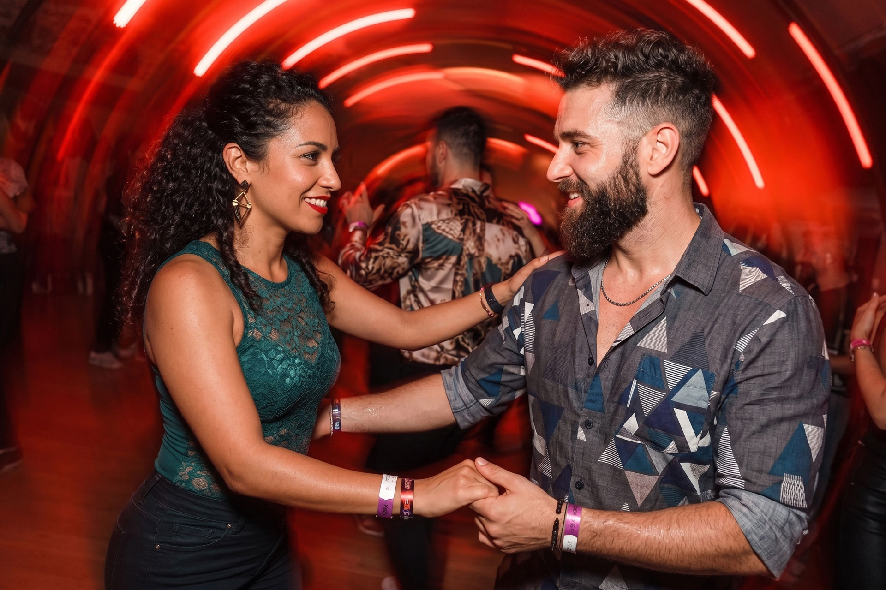
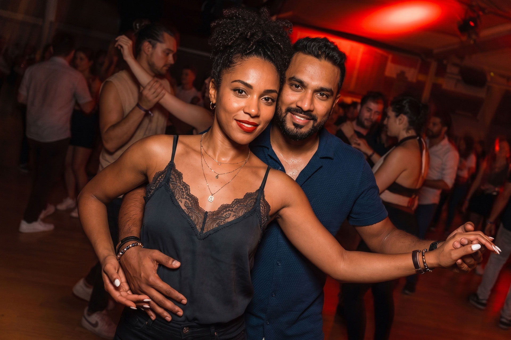

A salsa "congress" and a salsa "festival" are usually the same thing. A tango "marathon" is not a longer tango festival. A Lindy Hop "exchange" isn't a festival either, even when it lasts just as many days. Each dance scene developed its own vocabulary, so the same word can mean different things depending on who uses it.

This guide explains the multi-day formats you are most likely to meet in European social dance, from salsa, bachata, kizomba and zouk to tango, Lindy Hop and West Coast Swing. Two things to keep in mind:

* **Terminology is not standardised.** Even specialist directories disagree on details. We point out where they do.
* **Many events combine formats.** A congress can include a competition and an all-night social, and a tango marathon can offer optional classes. The programme tells you more than the label.

*Events named here are neutral examples based on their public pages as of 25 November 2026. They are not recommendations, and Revelti has no relationship with them.*

## The formats at a glance

**What happens**

| Format | Classes | Shows / competitions | Typical length |
| :--- | :--- | :--- | :--- |
| Congress / festival | Yes, the core of the day | Shows, often competitions | 3 to 4 days |
| Marathon | None, in the strict sense | None | About 3 to 4 days |
| Encuentro milonguero | Rarely | Rarely | About 3 days |
| Tango festival | Yes, with invited maestros | Shows, live music | 4 to 5 days or more |
| Lindy exchange | Few or none | Occasionally shows | A weekend |
| Swing festival or camp | Yes | Often competitions, live bands | A weekend to a month |
| WCS convention | Yes | Jack and Jill contests required | At least 3 days |

**How you get in**

| Format | Main scenes | Registration | Role balance |
| :--- | :--- | :--- | :--- |
| Congress / festival | Salsa, bachata, kizomba, zouk | Buy a pass | Sometimes, via role-specific tickets |
| Marathon | Tango, some salsa | Often curated | Usually balanced on purpose |
| Encuentro milonguero | Tango | Curated, sometimes by invitation | Balanced by definition |
| Tango festival | Tango | Usually open | Not usually managed |
| Lindy exchange | Lindy Hop, Balboa, blues | Register as a guest | Varies |
| Swing festival or camp | Lindy Hop, Balboa, solo jazz | Buy a pass | Sometimes managed |
| WCS convention | West Coast Swing | Buy a pass | Competitors enter in one role |

## Five questions that decode any event

1. **Are there classes?** If so, how many hours, and are they the main daytime activity?
2. **Is there a stage?** Shows and competitions shape the timetable and the atmosphere.
3. **How do you get in?** Buying a pass is not the same as applying and waiting to be accepted.
4. **Does the organiser balance leaders and followers?** Look for role-specific tickets, partner registration or a waiting list for one role.
5. **How many hours are set aside for social dancing?** A weekend built around 30 hours of workshops feels very different from one built around 30 hours of dancing.

## Congress and festival (salsa, bachata, kizomba, zouk)

In the Latin and Afro-Latin scenes, a **congress** is a multi-day event that combines workshops, shows and social dancing, sometimes with competitions. Wikipedia describes a salsa congress as "a multi-day dance festival featuring workshops" and gives "Salsa Festival" and "Salsa Summit" as other names for it. Salsa Vida's glossary says "salsa congress" has "gradually become less popular in favor of 'salsa festival'".

**So is a congress different from a festival?** In practice, no. Organisers use both words for the same format, sometimes on the same page: the Copenhagen Bachata Congress listing on go&dance is tagged "Weekend Festival".

Wikipedia and Salsa Vida both say the first salsa congress took place in Puerto Rico in 1997, organised by Eli Irizarry, and Wikipedia records a "World Salsa Congress" in Valencia in October 1999. We found no independent primary source for these dates, so treat them as the commonly cited history.

A typical day runs from workshops to evening shows to parties late into the night. Three examples from 2026:

* **Copenhagen Bachata Congress** (Denmark, October) listed "30+ hours of workshops", "3 amazing parties", styling bootcamps and a social dance competition open only to Full Pass holders. One ticket was an "Early Bird Full Pass - Leader", one way organisers manage role balance.
* **Bachatasia World Congress** (Bormujos, Seville, March) promised "workshops, shows and unforgettable parties", with a bachata and salsa ballroom plus a separate kizomba room.
* **Neverending Kizomba Festival** (Platja d'Aro, Girona, November) combined "24+ hours of workshops" and contests with what the organiser calls "80+ hours non-stop" of dancing. Its name says Barcelona, but the venue is on the Costa Brava, a good reason to check the address as well as the title.

If you mainly want to social dance at an event like this, look for a party-only pass.

*Social dancing at the evening party of a Latin dance event. Photo: Lutty Moreira.*

## Marathon: all dancing, no classes (usually)

The marathon is most clearly defined in **tango**. The Tango Marathon Directory (TMD), which lists over 3,000 tango events, says a marathon has "No workshops, no shows", only dancing, with "Closed registration with curated guest lists (not first-come, first-served)". The leader/follower balance is "typically aiming for exact 50/50, though some allow up to 4% more leaders". There is no live music either, and the typical length is 3 to 4 days, Friday evening to Sunday afternoon.

The idea exists in salsa too. The **Prague Salsa Marathon** is listed on Salsa Vida as focusing "on extended social dancing rather than classes, workshops, or shows", with registration "balanced between leaders and followers".

The label also drifts. The **Istanbul Dance Marathon SBK** (2024 edition) advertised six workshop rooms and more than 100 hours of classes, a congress programme under a marathon name. The **Barcelona Tango Marathon** (April 2026) asked dancers to register with a partner "to help us keep the balance on the dance floor", as marathons traditionally do, but also offered optional paid workshops.

**Where sources disagree.** TMD treats curated registration as part of the definition. Tango Portal says marathons "generally" have open registration and defines them as events running "for 12 hours or more". TangoFestivals.net says they have "few or no workshops" and last 2 to 4 days. We give more weight to TMD because it publishes its data and covers the most events, but always read the registration page.

## Encuentro milonguero

An **encuentro** is organised much like a tango marathon: closed, pre-registered and role-balanced. TMD calls encuentros "basically 'Marathons' in most ways". What differs is the culture on the floor, summed up by TMD as a "milonguero ethos; strict cabeceo, often smaller".

In 2014, Melina Sedó, whose writing on encuentros TMD quotes, published a checklist for recognising one. Dancers "invite each other by mirada & cabeceo", a look and a nod across the room. They "dance together one tanda only, then clear the dance floor during the cortina", the short musical break between sets. Organisers "admit an equal number of followers & leaders", and some encuentros seat men and women separately.

**Abrazame! Encuentro Milonguero Barcelona** (December 2025) was listed as emphasising "close embrace, mirada & cabeceo, and gender balance", with "33 hours of dancing across 6 main milongas".

**Where sources disagree.** TangoFestivals.net puts typical encuentros at "40 to 80 dancers", yet the Tango Rustico Encuentro in Znojmo, Czech Republic, expected about 130 in April 2026. "Often smaller than a marathon" is the safest description.

Encuentros suit experienced tango dancers who are at ease with the codes. If cabeceo is still new to you, a festival or your local milonga is a gentler place to practise.

## Tango festival, festivalito and milonga weekend

A **tango festival** is the open, programme-heavy format: TMD lists "Shows, workshops with maestros, formal milongas, live music", with registration that is "Usually open". Its data shows how distinct the formats are: of 271 festivals it categorised, 210 listed lessons, compared with 70 of 789 marathons. A **festivalito** is a smaller festival with fewer maestros. A **milonga weekend** strings several milongas together with no registration, so "there is no planned gender balance".

## Lindy exchange

In swing dancing, an **exchange** is a social weekend hosted by a local scene. A 2011 post on the ATOMIC Ballroom blog explains that exchanges "began as a way for communities to open and share their local swing dancing culture". Guests "are invited to stay in the homes of local dancers", and "many do not offer the variety workshops or lessons typically found at swing camps". DanceUS.org describes exchanges as "dancer-led gatherings, typically hosted rather than run as commercial festivals".

Dances often move between venues across the city. The **Edinburgh Lindy Exchange** (September 2026) was listed with a programme spanning "venues across the city, with live bands, DJs and social dancing". The **Madrid Swing Exchange** (May 2026) was described as "a social dance and live music exchange, with tasters and shows, without a level-based course programme". Short tasters like Madrid's are a common middle ground between no classes and a full programme.

## Swing festivals and camps

A **swing festival** looks more like a congress: classes by day, parties with live bands at night, and often competitions. **The Snowball** in Solna, Stockholm (26 to 31 December 2026) is listed with "six nights of social dancing across Lindy Hop, Balboa and Blues floors, live music", five days of classes and evening competitions.

A **camp** is the immersive version. **Herräng Dance Camp** in Sweden calls itself "a month-long international festival for swing dancers", split into four camp weeks with classes, "social dancing (around the clock)", live music, competitions, shows and talks. It has run since 1982.

## West Coast Swing conventions and Jack and Jill

West Coast Swing runs its own circuit, separate from Lindy Hop and Balboa events, according to DanceUS.org, and has the most formal definition of any format here. Events on the World Swing Dance Council (WSDC) Registry "offer a mix of social dancing, instruction and competition". Under the [2026 WSDC Registry Event Rules](https://worldsdc.com/wp-content/uploads/2026/03/Revised-WSDC-Registry-Event-Rules-Updated-Jan172026-V2026.1B.pdf), they must:

* run at least three days of West Coast Swing activities;
* hold WSDC Jack and Jill contests in at least two skill levels;
* reach at least 150 Jack and Jill competitor entries (80 in regions the WSDC designates as growth regions).

In a **Jack and Jill**, competitors are randomly matched with a partner and dance to music they haven't heard in advance, as Wikipedia explains. Only finalists earn points, and leaders' and followers' points are tracked separately.

## Socials and milongas: the weekly baseline

Most of these formats grow out of the evening social. Salsa Vida's Spanish glossary defines social dancing as partner dancing done "for enjoyment, connection and musical expression, rather than for performance or competition" (our translation). In tango, the equivalent is the **milonga**, which TMD describes as a dance event "with beginning and end". A few local socials or milongas are the best preparation for any weekend format.

*An evening social: partner dancing for its own sake, with no classes or shows. Photo: Lutty Moreira.*

Hybrids are common too: "marathon and festival" combinations, congresses with 24-hour socials, swing festivals that are close to exchanges. Treat the name as a hint, not a contract, and go back to the five questions.

## If you organise events

The label you choose sets expectations before anyone reads your programme:

* **Tango:** "marathon" and "encuentro" imply curated registration and role balance. If yours is open to all, say so clearly.
* **Swing:** "exchange" implies a social, community-hosted weekend. With a full class programme, "festival" is the less surprising word.
* **West Coast Swing:** presenting an event as a points event implies the WSDC Registry rules above.
* **Salsa, bachata, kizomba and zouk:** "congress" and "festival" are interchangeable, so your programme is what sets you apart.

The events in this guide show several ways to make the rules clear. Copenhagen sold role-specific tickets. Barcelona's tango marathon asked for partner registration, warned that solo followers might be waitlisted, and offered a "Double Role" option for people who both lead and follow. Prague's salsa marathon stated its balance outright. Whatever you choose, say what each pass includes and give the venue address, not just the city.

## If you photograph or film events

The format decides what there is to capture and when:

* **Congresses, festivals and WCS conventions** run on fixed schedules. Copenhagen held its competition final on the Saturday, followed by a party, and The Snowball runs competitions in the evenings, so you can plan coverage around set moments.
* **Marathons and encuentros** are almost entirely social dancing over long hours, such as Abrazame!'s 33 hours across six milongas. There is no stage, and the codes on the floor (cabeceo, tandas, clearing the floor between sets) shape when and where movement happens.
* **Exchanges** move between venues across a city, often with live bands, so the logistics resemble a small city festival.
* **Camps** such as Herräng run for weeks rather than days.

None of our sources describes photography practice at these events. Our recommendation: read each event's own media or photography policy before you shoot, and ask the organiser whether there is an official media team.

## Before you book

* Read the timetable, not just the title. Count the hours of classes and of social dancing.
* Check how registration works: open sale, partner registration, application or invitation.
* Look for role-specific tickets or waiting lists. They show that the organiser manages balance.
* Check what each pass covers. Party, day and full passes can differ a lot.
* Check the venue address. Event names don't always match the city.
* For an encuentro, make sure you are comfortable with cabeceo. For a WCS convention, check which Jack and Jill divisions you can enter.

*Last reviewed: 25 November 2026. Dates, venues and ticket names change between editions. Always check the organiser's current page.*

## Sources

Event details (dates, venues, programmes, ticket names) come from each event's public page or listing, as read on 25 November 2026.

**Tango**

* The Tango Marathon Directory, ["TMD at 17: A Data Story"](https://www.tangomarathons.com/wp-content/uploads/2026/01/2026-anniversary-17years.html), 18 January 2026
* The Tango Marathon Directory, ["Terminology"](https://www.tangomarathons.com/terminology/)
* Tango Portal, ["Tango Marathons: What They Are and Where to Find One"](https://tango-portal.pages.dev/blog/tango-marathons-guide/), 25 March 2026
* TangoFestivals.net, ["Festival, Marathon, or Encuentro: How to Choose"](https://tangofestivals.pages.dev/blog/festival-or-marathon), updated 9 February 2026
* Melina Sedó, ["Quo Vadis Encuentro Milonguero II"](https://melinas-two-cent.blogspot.com/2014/12/quo-vadis-encuentro-milonguero-ii.html), Melina's two cents, 2 December 2014

**Salsa, bachata and kizomba**

* Wikipedia, ["Salsa congress"](https://en.wikipedia.org/wiki/Salsa_congress)
* Salsa Vida, ["Salsa Congress"](https://www.salsavida.com/salsa-dance-terms/salsa-congress) (glossary)
* Salsa Vida, ["Baile Social"](https://www.salsavida.com/es/salsa-dance-terms/social-dancing/) (glossary, Spanish)

**Swing and West Coast Swing**

* Shani Brown, ["Sharing Our Love for Lindy Hop… the Lindy Exchange"](https://atomicballroom.com/blog/2011/06/21/sharing-our-love-for-lindy-hop-the-lindy-exchange/), ATOMIC Ballroom blog, 21 June 2011
* DanceUS.org, ["Swing Dance Festivals, Exchanges Worldwide"](https://danceus.org/events/swing/swing-dance-festivals-worldwide)
* Herräng Dance Camp, ["This is HDC"](https://www.herrang.com/about/about-hdc)
* World Swing Dance Council, ["2026 WSDC Registry Event Rules"](https://worldsdc.com/wp-content/uploads/2026/03/Revised-WSDC-Registry-Event-Rules-Updated-Jan172026-V2026.1B.pdf)
* Wikipedia, ["Jack and Jill (dance)"](https://en.wikipedia.org/wiki/Jack_and_Jill_%28dance%29)

**Photos**

* All photos: Lutty Moreira.
