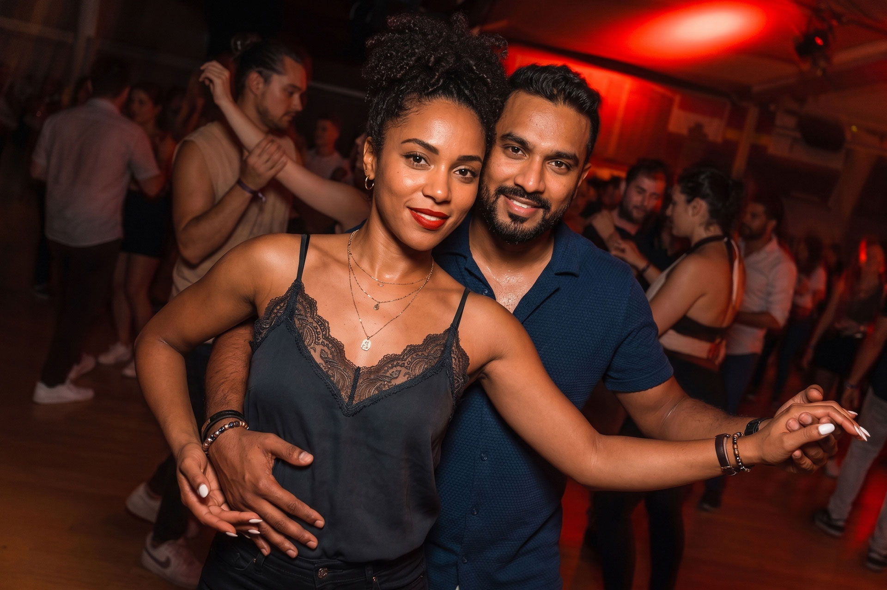
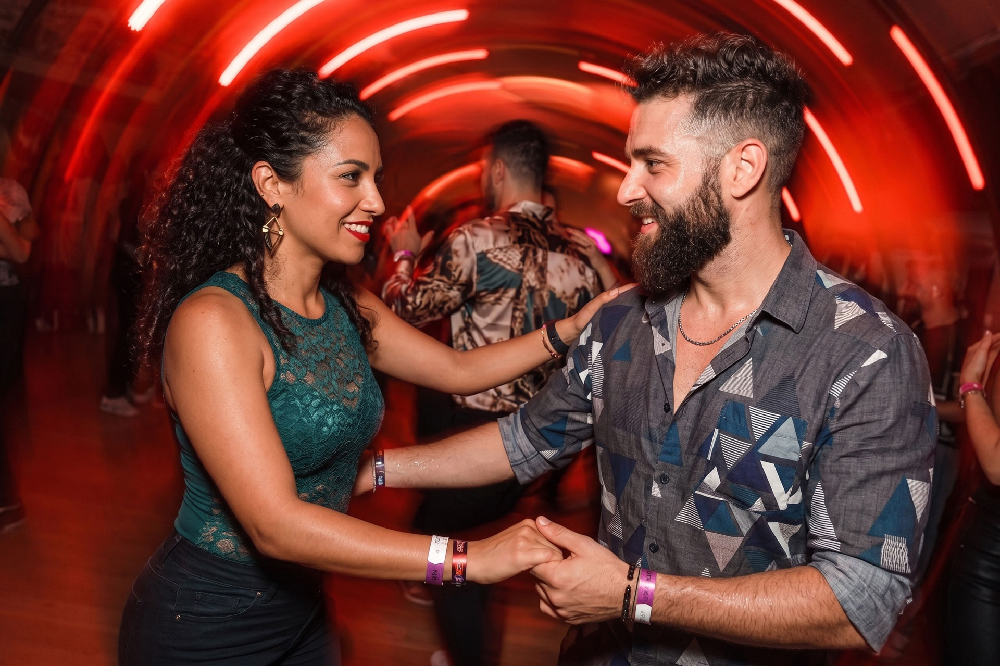

Si bailas salsa, bachata o kizomba en España, seguramente ya sabes qué es un congreso: talleres por el día, shows por la noche y fiesta hasta tarde. Lo que confunde es todo lo demás. ¿Un festival es otra cosa? ¿Qué es una maratón? ¿Y un encuentro milonguero, o un *exchange*?

Esta guía repasa los formatos de evento más habituales en el baile social europeo, de la salsa al tango y del lindy hop al West Coast Swing, con ejemplos reales. Antes, dos avisos:

* **Los nombres no están estandarizados.** Cada escena ha creado su propio vocabulario y hasta los directorios especializados discrepan en los detalles. Lo señalamos cuando ocurre.
* **Muchos eventos mezclan formatos.** Un congreso puede incluir una competición y un social de 24 horas, y una maratón de tango puede ofrecer clases opcionales. Manda el programa, no la etiqueta.

*Los eventos citados son ejemplos neutrales, según sus páginas públicas a 25 de noviembre de 2026. No son recomendaciones y Revelti no tiene ninguna relación con ellos.*

## Primero lo básico: qué es un social

Casi todos los formatos de esta guía nacen de un evento más sencillo: el **social**, una noche de baile en pareja sin clases ni espectáculo de por medio. Salsa Vida define el baile social como el baile en pareja "que se hace por disfrute, conexión y expresión musical, más que para una presentación o competencia". Los sociales pueden ser en estudios, discotecas o al aire libre, y también forman parte de festivales y congresos.

En tango, el equivalente es la **milonga**, "el lugar donde se baila", como la define Matador Network. Allí se baila por **tandas** de cuatro o cinco temas del mismo tipo (tangos, milongas o valses), separadas por un breve paréntesis de otra música. Parar a explicar figuras queda para las clases y las prácticas.

*Un social de noche: baile en pareja por el gusto de bailar, sin clases ni espectáculos. Foto: Lutty Moreira.*

## Congreso o festival: ¿hay diferencia?

En salsa, bachata, kizomba y zouk, un **congreso** es un evento de varios días que combina talleres, shows y baile social, a veces con competiciones. El glosario de Salsa Vida lo define como "un evento de varios días y gran escala dedicado a la salsa y otros bailes latinos", y añade que ese nombre ha ido cediendo terreno a "festival de salsa".

**La respuesta corta es que no hay diferencia práctica.** Las organizaciones usan ambas palabras para lo mismo, a veces en la misma página: el Vacílalo Congreso Madrid aparece en Salsa Vida etiquetado como "Festival de Bachata" y "Festival de Salsa". El propio Salsa Vida reconoce que estos eventos "tienen muchos nombres": congresos de salsa, festivales de bachata, festivales SBK, maratones de baile o fines de semana.

Según Wikipedia y Salsa Vida, el primer congreso de salsa se celebró en Puerto Rico en 1997, organizado por Eli Irizarry, y en octubre de 1999 Valencia acogió un "World Salsa Congress". No hemos encontrado una fuente primaria independiente que lo confirme, así que tómalo como la historia que se cita habitualmente.

Tres ejemplos en España y uno en el norte de Europa, todos de 2026:

* **Vacílalo Congreso Madrid** (septiembre) se anunciaba como "un fin de semana lleno de talleres, espectáculos y baile social", con fiestas temáticas y música en vivo.
* **Bachatasia World Congress** (Bormujos, Sevilla, marzo) prometía "talleres, shows y fiesta", con una sala de bachata y salsa y otra "100% kizomba". Vendía *Full Pass*, *Full Pass VIP* y paquetes con hotel.
* **Neverending Kizomba Festival** (Platja d'Aro, Girona, noviembre) sumaba más de 24 horas de talleres, concursos y lo que la organización llama "80+ hours non-stop" de baile. Aunque lleva "Barcelona" en el nombre, la sede está en la Costa Brava: conviene mirar la dirección y no solo el título.
* **Copenhagen Bachata Congress** (Dinamarca, octubre) ofrecía más de 30 horas de talleres, tres fiestas, *bootcamps* de estilo y una competición de baile social reservada a quien tuviera *Full Pass*. Entre sus entradas había un "Early Bird Full Pass - Leader", una de las formas de gestionar el equilibrio de roles.

Fíjate en que el vocabulario de las entradas suele quedarse en inglés incluso en páginas en español: *full pass*, *party pass*, *VIP*, *early bird*. Si solo quieres bailar por la noche, busca si existe un pase de fiestas.

*Baile social en la fiesta de noche de un evento de baile latino. Foto: Lutty Moreira.*

## Maratón: solo baile (casi siempre)

Donde mejor está definido el formato es en el **tango**. The Tango Marathon Directory (TMD), que recoge más de 3.000 eventos de tango, describe las maratones así: sin talleres ni espectáculos, solo baile, e inscripción cerrada con listas seleccionadas, no por orden de llegada. Buscan el equilibrio exacto entre *leaders* y *followers*, aunque algunas admiten hasta un 4 % más de *leaders*. Tampoco suele haber música en directo, y la duración típica es de tres o cuatro días, de viernes por la tarde a domingo.

La idea también existe en salsa. La **Maratón de Salsa de Praga** se presenta en Salsa Vida como un evento que "se centra en el baile social prolongado en lugar de clases, talleres o espectáculos", y cuya inscripción "está equilibrada entre líderes y seguidores".

Pero la etiqueta no siempre significa lo mismo. La **Istanbul Dance Marathon SBK** (edición de 2024) anunciaba seis salas de talleres con más de 100 horas de clases: un programa de congreso con nombre de maratón. La **Barcelona Tango Marathon** (abril de 2026) pedía inscribirse en pareja para mantener el equilibrio en la pista, como manda la tradición, y además ofrecía talleres opcionales de pago.

**Dónde discrepan las fuentes.** Para TMD, la inscripción seleccionada forma parte de la definición. Tango Portal dice que las maratones "generalmente" tienen inscripción abierta y las define por duración, a partir de 12 horas seguidas. TangoFestivals.net habla de "pocos o ningún taller" y de dos a cuatro días. Damos más peso a TMD porque publica sus datos y cubre más eventos, pero lo práctico es leer siempre la página de inscripción.

## Encuentro milonguero

El **encuentro** funciona como una maratón en lo logístico: inscripción previa, plazas limitadas y paridad de roles. TMD los describe como "básicamente maratones en casi todo". Lo que cambia es la cultura de pista: un "ethos milonguero", cabeceo estricto y, a menudo, menos gente.

En 2014, Melina Sedó, a quien TMD cita al hablar de encuentros, publicó una lista de rasgos para reconocer uno. La gente se invita por **mirada y cabeceo**, baila una sola tanda con cada pareja y despeja la pista durante la **cortina**, la pausa musical entre tandas. La organización admite el mismo número de *leaders* y *followers*, y algunos encuentros incluso separan los asientos de hombres y mujeres.

Aunque todo este vocabulario es español, en nuestras búsquedas casi toda la información sobre el formato aparecía en inglés. Un ejemplo cercano es **Abrazame! Encuentro Milonguero Barcelona** (diciembre de 2025), que destacaba el abrazo cerrado, la mirada y el cabeceo y el equilibrio entre roles, con 33 horas de baile repartidas en seis milongas.

**Dónde discrepan las fuentes.** TangoFestivals.net habla de encuentros de "40 a 80" participantes, pero el Tango Rustico de Znojmo, en Chequia, esperaba unas 130 personas en abril de 2026. Lo prudente es decir que suelen ser más pequeños que una maratón.

Los encuentros están pensados para quien ya baila tango con soltura y maneja los códigos. Si el cabeceo todavía te cuesta, empieza por un festival o por las milongas de tu ciudad.

## Festival de tango, festivalito y fin de semana de milongas

El **festival de tango** es el formato abierto y con más programa: espectáculos, talleres con maestros, milongas y música en vivo, con inscripción normalmente abierta. Los datos de TMD muestran lo distintos que son los formatos: de 271 festivales clasificados, 210 anunciaban clases, frente a solo 70 de 789 maratones. Un **festivalito** es un festival más pequeño, con menos maestros. Un **fin de semana de milongas** (*milonga weekend*) encadena varias milongas sin inscripción previa, y por eso no hay equilibrio de roles planificado.

## Swing: exchange, festival y campamento

En lindy hop y balboa, un **exchange** es un fin de semana social que organiza la comunidad local, y la palabra se queda en inglés también en España. Según un artículo de 2011 del blog de ATOMIC Ballroom, los exchanges nacieron como una forma de que cada comunidad abriera y compartiera su cultura de swing local. Quienes vienen de fuera suelen alojarse en casa de gente de la escena, y muchos exchanges no ofrecen la variedad de talleres de un campamento de swing. DanceUS.org los resume como reuniones dirigidas por la propia comunidad, más de anfitriones que comerciales.

El **Madrid Swing Exchange** (mayo de 2026), organizado por MAD for Swing, se describía como un exchange de baile social y música en directo, con *tasters* (clases de prueba) y shows, pero sin programa de cursos por niveles. Esas clases de prueba son un término medio habitual entre no dar clases y montar un programa completo.

El **festival de swing** se parece más a un congreso: clases de día, fiestas con banda en directo por la noche y, a menudo, competiciones. El Donosti Belle Swing Festival, que organiza de forma voluntaria una asociación de San Sebastián, ofrece "clases, competiciones y fiestas con música en directo". En Suecia, The Snowball (Solna, Estocolmo, del 26 al 31 de diciembre de 2026) anuncia seis noches de baile social en pistas de lindy hop, balboa y blues, cinco días de clases y competiciones nocturnas.

El **campamento** es la versión inmersiva. Herräng Dance Camp, en Suecia, se define como un festival internacional de swing de un mes, dividido en cuatro semanas, con clases, baile social "a todas horas", música en directo, competiciones, shows y charlas. Se celebra desde 1982.

## West Coast Swing: convenciones y Jack and Jill

El West Coast Swing tiene su propio circuito, separado del de lindy hop y balboa, y la definición más formal de todas. Los eventos del registro del **World Swing Dance Council (WSDC)** combinan baile social, formación y competición. Según las [normas del WSDC para 2026](https://worldsdc.com/wp-content/uploads/2026/03/Revised-WSDC-Registry-Event-Rules-Updated-Jan172026-V2026.1B.pdf) (en inglés), deben:

* durar al menos tres días;
* celebrar competiciones **Jack and Jill** de al menos dos niveles;
* reunir un mínimo de 150 inscripciones en esas competiciones (80 en las regiones que el WSDC considera en crecimiento).

En un **Jack and Jill**, cada participante se inscribe en un rol y baila con una pareja asignada al azar, con música que no conoce de antemano. Solo puntúa quien llega a la final, y los puntos de *leaders* y *followers* se registran por separado.

## Tabla comparativa

**Qué pasa en cada formato**

| Formato | Clases | Shows / competiciones | Duración habitual |
| :--- | :--- | :--- | :--- |
| Social / milonga | No | No | Una noche |
| Congreso / festival | Sí, son el centro del día | Shows y a menudo competiciones | De 3 a 4 días |
| Maratón | No, en sentido estricto | No | De 3 a 4 días |
| Encuentro milonguero | Rara vez | Rara vez | Unos 3 días |
| Festival de tango | Sí, con maestros | Shows, música en vivo | De 4 a 5 días o más |
| Exchange | Pocas o ninguna | A veces shows | Un fin de semana |
| Festival o campamento de swing | Sí | Competiciones, bandas | De un fin de semana a un mes |
| Convención WCS | Sí | Jack and Jill obligatorios | Mínimo 3 días |

**Cómo se entra**

| Formato | Escenas | Inscripción | Equilibrio de roles |
| :--- | :--- | :--- | :--- |
| Social / milonga | Todas | Entrada para una noche | No |
| Congreso / festival | Salsa, bachata, kizomba, zouk | Compras un pase | A veces, con entradas por rol |
| Maratón | Tango (y algo de salsa) | A menudo seleccionada | Casi siempre buscado |
| Encuentro milonguero | Tango | Seleccionada o por invitación | Por definición |
| Festival de tango | Tango | Normalmente abierta | No suele gestionarse |
| Exchange | Lindy hop, balboa, blues | Inscripción previa | Variable |
| Festival o campamento de swing | Lindy hop, balboa, solo jazz | Compras un pase | A veces |
| Convención WCS | West Coast Swing | Compras un pase | Se compite en un solo rol |

## Si organizas eventos

El nombre que eliges crea expectativas antes de que nadie lea tu programa:

* **Tango:** "maratón" y "encuentro" implican inscripción seleccionada y paridad de roles. Si el tuyo es abierto, dilo claramente.
* **Swing:** "exchange" implica un fin de semana social con la comunidad local como anfitriona. Con un programa completo de clases, "festival" sorprenderá menos.
* **West Coast Swing:** presentarlo como evento de puntos implica cumplir las normas del registro del WSDC.
* **Salsa, bachata, kizomba y zouk:** "congreso" y "festival" son intercambiables, así que lo que distingue tu evento es el programa.

Los eventos de esta guía muestran varias maneras de dejar claras las condiciones. Copenhague vendía entradas por rol. La Barcelona Tango Marathon pedía inscribirse en pareja, avisaba de que los *followers* sin pareja podían quedar en lista de espera y ofrecía una opción de "doble rol" para quien lleva y sigue. La maratón de salsa de Praga indicaba abiertamente su equilibrio de roles. Hagas lo que hagas, explica qué incluye cada pase y da la dirección de la sede, no solo la ciudad.

## Si fotografías o grabas eventos

El formato decide qué hay que contar y cuándo:

* **Congresos, festivales y convenciones de WCS** tienen horarios fijos. En Copenhague, la final de la competición fue el sábado, seguida de fiesta, y The Snowball celebra sus competiciones por las noches, así que puedes planificar la cobertura en torno a momentos concretos.
* **Maratones y encuentros** son casi solo baile social durante muchas horas, como las 33 horas de Abrazame!. No hay escenario, y los códigos de pista (cabeceo, tandas, pista vacía durante la cortina) determinan cuándo y dónde hay movimiento.
* **Los exchanges** se mueven por varias salas de la ciudad, a menudo con música en directo, y la logística se parece a la de un pequeño festival urbano.
* **Los campamentos** como Herräng duran semanas, no días.

Ninguna de nuestras fuentes describe cómo se trabaja la fotografía en estos eventos. Nuestra recomendación: antes de empezar, lee la política de fotografía y vídeo de cada evento y pregunta a la organización si hay un equipo audiovisual oficial.

## Antes de reservar

* Lee el horario, no solo el título: cuenta las horas de clase y las de baile social.
* Mira cómo funciona la inscripción: venta libre, en pareja, por solicitud o por invitación.
* Busca entradas por rol o listas de espera, que indican que la organización cuida el equilibrio.
* Comprueba qué incluye cada pase: *full pass*, pase de día y pase de fiestas pueden ser muy distintos.
* Revisa la dirección de la sede: el nombre del evento no siempre coincide con la ciudad.
* Si vas a un encuentro, asegúrate de manejar el cabeceo. Si vas a una convención de WCS, comprueba en qué categorías de Jack and Jill puedes competir.

*Última revisión: 25 de noviembre de 2026. Fechas, sedes y nombres de entradas cambian de una edición a otra; consulta siempre la página actual de la organización.*

## Fuentes

Las citas de fuentes en inglés están traducidas por Revelti. Los datos de cada evento (fechas, sedes, programas y entradas) proceden de su página pública o de su ficha en directorios de eventos, consultadas el 25 de noviembre de 2026.

**Tango**

* The Tango Marathon Directory, ["TMD at 17: A Data Story"](https://www.tangomarathons.com/wp-content/uploads/2026/01/2026-anniversary-17years.html), 18 de enero de 2026 (en inglés)
* The Tango Marathon Directory, ["Terminology"](https://www.tangomarathons.com/terminology/) (en inglés)
* Tango Portal, ["Tango Marathons: What They Are and Where to Find One"](https://tango-portal.pages.dev/blog/tango-marathons-guide/), 25 de marzo de 2026 (en inglés)
* TangoFestivals.net, ["Festival, Marathon, or Encuentro: How to Choose"](https://tangofestivals.pages.dev/blog/festival-or-marathon), actualizado el 9 de febrero de 2026 (en inglés)
* Melina Sedó, ["Quo Vadis Encuentro Milonguero II"](https://melinas-two-cent.blogspot.com/2014/12/quo-vadis-encuentro-milonguero-ii.html), 2 de diciembre de 2014 (en inglés)
* Natalia Montaldo, ["Mini guía para entender los códigos del tango y las milongas"](https://matadornetwork.com/es/mini-guia-para-entender-los-codigos-del-tango-y-las-milongas/), Matador Network, 13 de marzo de 2015

**Salsa, bachata y kizomba**

* Salsa Vida, ["Congreso de Salsa"](https://www.salsavida.com/es/salsa-dance-terms/salsa-congress/) y ["Baile Social"](https://www.salsavida.com/es/salsa-dance-terms/social-dancing/) (glosario)
* Takeshi Young, ["Tu primer festival de baile latino"](https://www.salsavida.com/es/articles/first-latin-dance-festival/), Salsa Vida
* Wikipedia, ["Salsa congress"](https://en.wikipedia.org/wiki/Salsa_congress) (en inglés)

**Swing y West Coast Swing**

* Shani Brown, ["Sharing Our Love for Lindy Hop… the Lindy Exchange"](https://atomicballroom.com/blog/2011/06/21/sharing-our-love-for-lindy-hop-the-lindy-exchange/), blog de ATOMIC Ballroom, 21 de junio de 2011 (en inglés)
* DanceUS.org, ["Swing Dance Festivals, Exchanges Worldwide"](https://danceus.org/events/swing/swing-dance-festivals-worldwide) (en inglés)
* Donosti Lindy Hop Dantza eta Kultur Elkartea, ["Donosti Belle Swing Festival: Open Program"](https://sites.google.com/view/donostibelleswing/english/open-program) (en inglés)
* Herräng Dance Camp, ["This is HDC"](https://www.herrang.com/about/about-hdc) (en inglés)
* World Swing Dance Council, ["2026 WSDC Registry Event Rules"](https://worldsdc.com/wp-content/uploads/2026/03/Revised-WSDC-Registry-Event-Rules-Updated-Jan172026-V2026.1B.pdf) (en inglés)
* Wikipedia, ["Jack and Jill (dance)"](https://en.wikipedia.org/wiki/Jack_and_Jill_%28dance%29) (en inglés)

**Fotos**

* Todas las fotos: Lutty Moreira.
